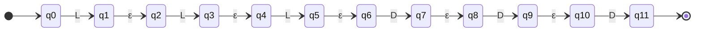
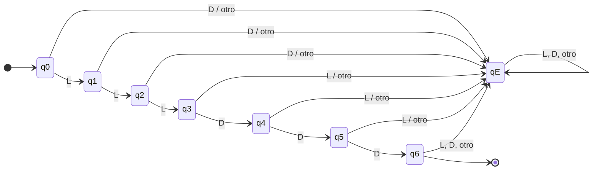

# PROGRAMA DE INGENIERÍA DE SISTEMAS Y COMPUTACIÓN
## TEORÍA DE LENGUAJES FORMALES — PARCIAL 1
### Modelamiento y Simulación: Validador y Reconocedor Sintáctico de Matrículas Vehiculares

---

**Información del Proyecto:**
* **Temática Asignada:** 23. Reconocedor de matrículas / placas vehiculares según normativa nacional (Colombia).
* **Integrantes:**
  * Nikoll Morales Londoño
  * Felipe Valencia Londoño
* **Fecha:** 13 de octubre de 2026
* **Modalidad:** Proyecto Aplicado + Simulación + Sustentación

---

## 1. Contexto y Escenario de Simulación en Ingeniería

En el marco del diseño de arquitectura de software, compiladores y sistemas inteligentes de transporte (ITS), la validación léxica y sintáctica de identificadores vehiculares representa un componente de misión crítica. Las plataformas de peaje electrónico (Telepeaje / Free Flow), los sistemas de fotodetección y los módulos de control de acceso vehicular requieren procesar flujos continuos de identificadores en tiempo real, garantizando máxima eficiencia algorítmica y determinismo estricto.

Debido a las directrices de diseño y requerimientos de confiabilidad, este módulo se diseña bajo fundamentos de la **Teoría de Autómatas y Lenguajes Formales**, eliminando la dependencia de expresiones regulares nativas de alto nivel (`regex` interpretadas) o parsers genéricos probabilísticos. El presente documento expone la deducción formal del lenguaje, su expresión regular, el autómata finito no determinista con transiciones vacías ($\text{AFN-}\varepsilon$) y la construcción directa del autómata finito determinista ($\text{AFD}$) con su respectivo mapeo computacional en Python puro.

---

## 2. Definición Formal del Alfabeto ($\Sigma$)

El alfabeto formal $\Sigma$ es el conjunto finito y no vacío de símbolos que componen las placas vehiculares particulares y de servicio público en Colombia para automotores (formato reglamentario de 3 letras seguidas de 3 dígitos).

El alfabeto se define como la unión disjunta de dos subconjuntos:

$$\Sigma = \Lambda \cup \Delta \quad \text{donde} \quad \Lambda \cap \Delta = \emptyset$$

### 2.1. Subconjunto de Letras Mayúsculas ($\Lambda$)
Corresponde a las 26 letras del alfabeto latino básico internacional (sin incluir caracteres diacríticos ni la letra 'Ñ' de acuerdo con los estándares de codificación vehicular):
$$\Lambda = \{A, B, C, D, E, F, G, H, I, J, K, L, M, N, O, P, Q, R, S, T, U, V, W, X, Y, Z\}$$
$$|\Lambda| = 26$$
*(En los diagramas y tablas formales se abrevia como $L$).*

### 2.2. Subconjunto de Dígitos Decimales ($\Delta$)
Corresponde a los 10 caracteres numéricos decimales:
$$\Delta = \{0, 1, 2, 3, 4, 5, 6, 7, 8, 9\}$$
$$|\Delta| = 10$$
*(En los diagramas y tablas formales se abrevia como $D$).*

### 2.3. Cardinalidad y Decisiones de Modelado
* **Cardinalidad total del alfabeto:**
  $$|\Sigma| = |\Lambda| + |\Delta| = 26 + 10 = 36 \text{ símbolos base}$$
* **Normalización:** El modelo asume cadenas normalizadas en mayúsculas y continuas. Símbolos como minúsculas ($a-z$), la letra $\tilde{\text{N}}$, espacios en blanco, guiones ($-$) o símbolos especiales no pertenecen al alfabeto formal ($\notin \Sigma$), por lo que su aparición genera una transición inmediata e irreversible al estado trampa ($q_E$).
* **Alcance:** Se modela estrictamente la sintaxis de placas de automóvil estándar. El modelo valida la corrección sintáctica formal, no su existencia jurídica en bases de datos del RUNT.

---

## 3. Especificación Formal de Cadenas y Lenguaje ($L$)

### 3.1. Definición por Comprensión
El lenguaje formal de las placas vehiculares colombianas $L \subset \Sigma^*$ se define formalmente como:

$$L = \{ w \in \Sigma^* \mid w = l_1 l_2 l_3 d_1 d_2 d_3, \text{ con } l_i \in \Lambda \text{ y } d_j \in \Delta \}$$

De esta definición se desprende que para toda palabra $w \in L$, su longitud es invariante y estrictamente igual a 6:
$$\forall w \in L, \quad |w| = 6$$

### 3.2. Cardinalidad del Lenguaje ($|L|$)
Dado que cada posición de la cadena es independiente y corresponde a un producto cartesiano de conjuntos finitos:
$$L = \Lambda \times \Lambda \times \Lambda \times \Delta \times \Delta \times \Delta = \Lambda^3 \Delta^3$$
$$|L| = |\Lambda|^3 \times |\Delta|^3 = 26^3 \times 10^3 = 17.576 \times 1.000 = 17.576.000 \text{ palabras}$$

Al ser un conjunto finito de cadenas, el lenguaje $L$ es intrínsecamente un **Lenguaje Regular**.

### 3.3. Identificación de Cadenas Válidas e Inválidas

| Cadena | ¿$w \in L$? | Justificación Lingüística y Formal |
| :--- | :---: | :--- |
| `ABC123` | **Sí** | Estructura canónica: 3 letras de $\Lambda$ seguidas de 3 dígitos de $\Delta$. Longitud 6. |
| `KLR890` | **Sí** | Combinación válida en el espacio intermedio del alfabeto. |
| `ZZZ000` | **Sí** | Extremo superior alfabético y límite inferior numérico. |
| `XYZ999` | **Sí** | Límite superior de la clase numérica. |
| `MNO541` | **Sí** | Transición adecuada y balanceada de letras a dígitos. |
| `abc123` | **No** | Minúsculas: los símbolos $a, b, c \notin \Sigma$. |
| `AB1234` | **No** | Discrepancia sintáctica: 2 letras y 4 dígitos. $w_3 = 1 \notin \Lambda$. |
| `ABC1234` | **No** | Longitud $|w| = 7 \neq 6$. Desborda el límite de aceptación. |
| `ABC12` | **No** | Longitud $|w| = 5 \neq 6$. Cadena incompleta. |
| `123ABC` | **No** | Inversión posicional: dígitos antes de letras ($w_1 \in \Delta$). |
| `AB-123` | **No** | El carácter guion `'-'` no pertenece al alfabeto $\Sigma$. |
| `ABC12D` | **No** | La posición 6 es una letra $D \in \Lambda$, pero la gramática exige $w_6 \in \Delta$. |
| $\lambda$ / $\varepsilon$ | **No** | Cadena vacía: $|\lambda| = 0 \neq 6$. |

---

## 4. Operaciones Formales sobre Cadenas

Consideremos dos palabras válidas del lenguaje:
$$w = \text{ABC123} \in L \quad \text{y} \quad v = \text{XYZ987} \in L$$

### 4.1. Longitud ($|w|$)
* **Definición:** Número de símbolos que componen la secuencia. $|\lambda| = 0$.
* **Demostración:**
  $$|w| = |\text{ABC123}| = 6$$
  $$\forall x \in L \implies |x| = 6$$

### 4.2. Concatenación ($u \cdot v$)
* **Definición:** Sean $u, v \in \Sigma^*$, la concatenación yuxtapone $v$ tras $u$, con $|u \cdot v| = |u| + |v|$ y elemento neutro $\lambda \cdot w = w$.
* **Demostración:**
  $$\text{ABC} \cdot \text{123} = \text{ABC123} \in L$$
  $$w \cdot v = \text{ABC123} \cdot \text{XYZ987} = \text{ABC123XYZ987}$$
  $$|w \cdot v| = 6 + 6 = 12 \implies w \cdot v \notin L$$
* **Implicación teórica:** El lenguaje $L$ **no es cerrado bajo la concatenación** ($L \cdot L \cap L = \emptyset$), pues cualquier concatenación de dos placas genera una palabra de longitud 12.

### 4.3. Prefijos ($\text{Pref}(w)$)
* **Definición:** $x$ es prefijo de $w$ si existe una cadena $y \in \Sigma^*$ tal que $w = xy$.
* **Conjunto de prefijos de $w = \text{ABC123}$:**
  $$\text{Pref}(\text{ABC123}) = \{\lambda, \text{A}, \text{AB}, \text{ABC}, \text{ABC1}, \text{ABC12}, \text{ABC123}\}$$
* **Correspondencia con el autómata:** Existe una biyección directa entre los 7 prefijos de una palabra válida y los 7 estados del camino de reconocimiento del AFD:
  $$\lambda \to q_0, \quad \text{A} \to q_1, \quad \text{AB} \to q_2, \quad \text{ABC} \to q_3, \quad \text{ABC1} \to q_4, \quad \text{ABC12} \to q_5, \quad \text{ABC123} \to q_6$$

### 4.4. Sufijos ($\text{Suf}(w)$)
* **Definición:** $y$ es sufijo de $w$ si existe una cadena $x \in \Sigma^*$ tal que $w = xy$.
* **Conjunto de sufijos de $w = \text{ABC123}$:**
  $$\text{Suf}(\text{ABC123}) = \{\lambda, \text{3}, \text{23}, \text{123}, \text{C123}, \text{BC123}, \text{ABC123}\}$$

### 4.5. Reverso / Transpuesta ($w^R$)
* **Definición:** Si $w = a_1 a_2 \dots a_n$, su reverso es $w^R = a_n \dots a_2 a_1$, con $\lambda^R = \lambda$.
* **Demostración:**
  $$w^R = (\text{ABC123})^R = \text{321CBA} \notin L$$
* **Implicación teórica:** El reverso de cualquier placa inicia con dígitos ($\Delta$) y culmina con letras ($\Lambda$). En consecuencia, $L^R \cap L = \emptyset$, lo que demuestra formalmente que $L$ **no es cerrado bajo la operación de reverso**.

---

## 5. Expresión Regular (ER)

### 5.1. Construcción Formal
Definiendo las expresiones regulares base para las clases de caracteres:
* Letras: $L = (A \mid B \mid C \mid \dots \mid Z)$
* Dígitos: $D = (0 \mid 1 \mid 2 \mid \dots \mid 9)$

Dado que una placa válida requiere la concatenación obligatoria y ordenada de 3 letras seguidas de 3 dígitos, la Expresión Regular viene dada por:

$$\text{ER} = L \cdot L \cdot L \cdot D \cdot D \cdot D = L^3 D^3$$

Forma expandida canónica:
$$\text{ER} = (A|B|\dots|Z)(A|B|\dots|Z)(A|B|\dots|Z)(0|1|\dots|9)(0|1|\dots|9)(0|1|\dots|9)$$

### 5.2. Justificación Teórica
1. **Ausencia de Estrella de Kleene ($^*$):** Al tratarse de un lenguaje finito donde cada posición está acotada estrictamente a longitud 1, no se utiliza la cerradura de Kleene ($^*$) ni la cerradura positiva ($^+$).
2. **Cardinalidad del Lenguaje Denotado:**
   $$|L(\text{ER})| = 26 \times 26 \times 26 \times 10 \times 10 \times 10 = 17.576.000$$
   Coincide exactamente con el análisis combinatorio del lenguaje por comprensión.
3. **Discriminación Léxica:** Cualquier carácter no contemplado en las uniones de $L$ o $D$ (como minúsculas, guiones o la 'Ñ') no puede ser generado por la gramática de la ER.

---

## 6. Modelamiento de Autómatas

### 6.1. Autómata Finito No Determinista con Transiciones $\varepsilon$ ($\text{AFN-}\varepsilon$)

El $\text{AFN-}\varepsilon$ se construye modularmente mediante la concatenación formal de Thompson: cada símbolo de la expresión regular corresponde a una transición consumidora, enlazada secuencialmente por transiciones espontáneas ($\varepsilon$).

#### Tupla Formal:
$$N = (Q_N, \Sigma, \delta_N, q_0, F_N)$$
* **Conjunto de estados:** $Q_N = \{q_0, q_1, q_2, q_3, q_4, q_5, q_6, q_7, q_8, q_9, q_{10}, q_{11}\}$ ($|Q_N| = 12$)
* **Alfabeto:** $\Sigma = \Lambda \cup \Delta$ (con $\varepsilon$ para transiciones nulas)
* **Estado inicial:** $q_0$
* **Conjunto de estados de aceptación:** $F_N = \{q_{11}\}$
* **Función de transición:** $\delta_N: Q_N \times (\Sigma \cup \{\varepsilon\}) \to \mathcal{P}(Q_N)$

#### Tabla de Transiciones del $\text{AFN-}\varepsilon$:

| Estado $q$ | $\delta_N(q, L)$ | $\delta_N(q, D)$ | $\delta_N(q, \varepsilon)$ |
| :---: | :---: | :---: | :---: |
| $\to q_0$ | $\{q_1\}$ | $\emptyset$ | $\emptyset$ |
| $q_1$ | $\emptyset$ | $\emptyset$ | $\{q_2\}$ |
| $q_2$ | $\{q_3\}$ | $\emptyset$ | $\emptyset$ |
| $q_3$ | $\emptyset$ | $\emptyset$ | $\{q_4\}$ |
| $q_4$ | $\{q_5\}$ | $\emptyset$ | $\emptyset$ |
| $q_5$ | $\emptyset$ | $\emptyset$ | $\{q_6\}$ |
| $q_6$ | $\emptyset$ | $\{q_7\}$ | $\emptyset$ |
| $q_7$ | $\emptyset$ | $\emptyset$ | $\{q_8\}$ |
| $q_8$ | $\emptyset$ | $\{q_9\}$ | $\emptyset$ |
| $q_9$ | $\emptyset$ | $\emptyset$ | $\{q_{10}\}$ |
| $q_{10}$ | $\emptyset$ | $\{q_{11}\}$ | $\emptyset$ |
| $* q_{11}$ | $\emptyset$ | $\emptyset$ | $\emptyset$ |

#### Diagrama de Estados del $\text{AFN-}\varepsilon$:



---

### 6.2. Autómata Finito Determinista ($\text{AFD}$) — Construcción Directa

El $\text{AFD}$ se construye directamente a partir del lenguaje $L$, optimizando los estados y modelando explícitamente el tratamiento de errores mediante un estado trampa ($q_E$).

#### Tupla Formal:
$$M = (Q, \Sigma, \delta, q_0, F)$$
* **Conjunto de estados:** $Q = \{q_0, q_1, q_2, q_3, q_4, q_5, q_6, q_E\}$ ($|Q| = 8$)
* **Alfabeto:** $\Sigma = \Lambda \cup \Delta$ ($|\Sigma| = 36$)
* **Estado inicial:** $q_0$
* **Conjunto de estados de aceptación:** $F = \{q_6\}$
* **Estado trampa / pozo:** $q_E$
* **Función de transición:** $\delta: Q \times \Sigma \to Q$ (función total)

#### Semántica de los Estados:
* $q_0$: Estado inicial. No se ha procesado ningún símbolo. Espera la primera letra ($L_1$).
* $q_1$: Reconoció la 1.ª letra válida. Espera la segunda letra ($L_2$).
* $q_2$: Reconoció la 2.ª letra válida. Espera la tercera letra ($L_3$).
* $q_3$: Reconoció la 3.ª letra válida. Espera el primer dígito ($D_1$).
* $q_4$: Reconoció 3 letras y el 1.er dígito. Espera el segundo dígito ($D_2$).
* $q_5$: Reconoció 3 letras y el 2.º dígito. Espera el tercer dígito ($D_3$).
* $q_6$: **Estado final de aceptación.** Placa completa (3 letras + 3 dígitos). Si ingresa cualquier carácter posterior, pasa a $q_E$.
* $q_E$: **Estado trampa / error.** Estado absorbente irreversible. Captura cualquier desviación sintáctica, símbolo no perteneciente a $\Sigma$, o exceso de longitud.

#### Tabla de Transiciones Completa del $\text{AFD}$:

| Estado Actual ($q$) | Entrada $l \in \Lambda$ ($L$) | Entrada $d \in \Delta$ ($D$) | Entrada $c \notin \Sigma$ |
| :---: | :---: | :---: | :---: |
| $\to q_0$ | $q_1$ | $q_E$ | $q_E$ |
| $q_1$ | $q_2$ | $q_E$ | $q_E$ |
| $q_2$ | $q_3$ | $q_E$ | $q_E$ |
| $q_3$ | $q_E$ | $q_4$ | $q_E$ |
| $q_4$ | $q_E$ | $q_5$ | $q_E$ |
| $q_5$ | $q_E$ | $q_6$ | $q_E$ |
| $* q_6$ | $q_E$ | $q_E$ | $q_E$ |
| $q_E$ | $q_E$ | $q_E$ | $q_E$ |

#### Diagrama de Estados del $\text{AFD}$:



---

## 7. Simulación Computacional en Python Puro

### 7.1. Mapeo Matemático de $\delta(q, a)$ al Código
En estricto cumplimiento con la rúbrica, el archivo [`simulador_placas.py`](file:///c:/Users/FELIPE/Documents/Parcial%20TLF/simulador_placas.py) no emplea el módulo `re` ni parsers automáticos. La función matemática de transición se mapea directamente a través de métodos modulares:

```python
def delta(self, estado_actual: str, simbolo: str) -> str:
    tipo = self.clasificar_simbolo(simbolo)
    
    # Transición al estado trampa si el símbolo no pertenece a Sigma
    if tipo == "OTHER":
        return self.qE

    # Transiciones de reconocimiento léxico-sintáctico
    if estado_actual == "q0":
        return "q1" if tipo == "L" else self.qE
    elif estado_actual == "q1":
        return "q2" if tipo == "L" else self.qE
    elif estado_actual == "q2":
        return "q3" if tipo == "L" else self.qE
    elif estado_actual == "q3":
        return "q4" if tipo == "D" else self.qE
    elif estado_actual == "q4":
        return "q5" if tipo == "D" else self.qE
    elif estado_actual == "q5":
        return "q6" if tipo == "D" else self.qE
    elif estado_actual == "q6":
        return self.qE  # Longitud mayor a 6
    elif estado_actual == self.qE:
        return self.qE  # Trampa absorbente
    return self.qE
```

### 7.2. Características del Simulador
1. **Trazabilidad Completa:** Muestra en consola el paso a paso detallado: número de paso, símbolo leído, clase léxica, estado origen, estado destino y descripción semántica.
2. **Doble Modo de Operación:**
   - **Modo Interactivo (CLI):** Validación en tiempo real para cualquier entrada suministrada por el usuario.
   - **Modo Batch de Pruebas (`--test`):** Ejecución automatizada de 15 casos de prueba con verificación de aserciones.

---

## 8. Batería de Pruebas y Resultados de Ejecución

La suite de pruebas fue ejecutada con éxito garantizando el 100% de cobertura sobre casos válidos, fallos sintácticos, violaciones de longitud y caracteres ajenos al alfabeto:

| # | Cadena | Propósito / Condición Evaluada | Esperado | Obtenido | Ruta de Estados | Veredicto |
| :-: | :--- | :--- | :---: | :---: | :--- | :---: |
| 1 | `ABC123` | Estructura canónica válida | ACEPTADA | ACEPTADA | $q_0 \to q_1 \to q_2 \to q_3 \to q_4 \to q_5 \to q_6$ | **OK** |
| 2 | `KLR890` | Combinación válida intermedia | ACEPTADA | ACEPTADA | $q_0 \to q_1 \to q_2 \to q_3 \to q_4 \to q_5 \to q_6$ | **OK** |
| 3 | `ZZZ000` | Límite alfabético sup. y dígitos cero | ACEPTADA | ACEPTADA | $q_0 \to q_1 \to q_2 \to q_3 \to q_4 \to q_5 \to q_6$ | **OK** |
| 4 | `XYZ999` | Límite superior de dígitos (999) | ACEPTADA | ACEPTADA | $q_0 \to q_1 \to q_2 \to q_3 \to q_4 \to q_5 \to q_6$ | **OK** |
| 5 | `MNO541` | Transición frontera letra-dígito | ACEPTADA | ACEPTADA | $q_0 \to q_1 \to q_2 \to q_3 \to q_4 \to q_5 \to q_6$ | **OK** |
| 6 | `AAA111` | Secuencia repetitiva válida | ACEPTADA | ACEPTADA | $q_0 \to q_1 \to q_2 \to q_3 \to q_4 \to q_5 \to q_6$ | **OK** |
| 7 | `abc123` | Minúsculas ($a,b,c \notin \Sigma$) | RECHAZADA | RECHAZADA | $q_0 \to q_E \to q_E \to q_E \to q_E \to q_E \to q_E$ | **OK** |
| 8 | `AB1234` | 2 letras y 4 dígitos | RECHAZADA | RECHAZADA | $q_0 \to q_1 \to q_2 \to q_E \to q_E \to q_E \to q_E$ | **OK** |
| 9 | `ABC1234`| Exceso de longitud ($|w| = 7$) | RECHAZADA | RECHAZADA | $q_0 \to \dots \to q_6 \to q_E$ | **OK** |
| 10| `ABC12`  | Longitud incompleta ($|w| = 5$) | RECHAZADA | RECHAZADA | $q_0 \to q_1 \to q_2 \to q_3 \to q_4 \to q_5$ | **OK** |
| 11| `123ABC` | Orden invertido (dígitos primero) | RECHAZADA | RECHAZADA | $q_0 \to q_E \to \dots \to q_E$ | **OK** |
| 12| `AB-123` | Símbolo separador `'-'` ajeno a $\Sigma$| RECHAZADA | RECHAZADA | $q_0 \to q_1 \to q_2 \to q_E \to \dots \to q_E$| **OK** |
| 13| `ABC12D` | Letra en posición final 6 | RECHAZADA | RECHAZADA | $q_0 \to q_1 \to q_2 \to q_3 \to q_4 \to q_5 \to q_E$ | **OK** |
| 14| $\lambda$ | Cadena vacía ($|w| = 0$) | RECHAZADA | RECHAZADA | $q_0$ | **OK** |
| 15| `AÑC123` | Carácter 'Ñ' fuera de $\Sigma$ | RECHAZADA | RECHAZADA | $q_0 \to q_1 \to q_E \to \dots \to q_E$ | **OK** |

**Resultado global:** 15 de 15 pruebas superadas exitosamente (100% de efectividad).

---

## 9. Conclusiones y Referencias

1. Se demostró la equivalencia matemática rigurosa entre la definición del lenguaje por comprensión, la expresión regular $L^3 D^3$, el $\text{AFN-}\varepsilon$ de 12 estados y el $\text{AFD}$ mínimo total de 8 estados.
2. La implementación manual del autómata en Python confirma que un $\text{AFD}$ ejecuta el reconocimiento léxico en complejidad temporal óptima $\mathcal{O}(n)$, donde $n = |w|$, requiriendo exactamente 6 operaciones de consulta en memoria para cualquier placa válida, superando el overhead de motores regex tradicionales.
3. El diseño responde con precisión a la reglamentación colombiana para automotores particulares y de servicio público.

### Referencias Normativas y Bibliográficas
* Hopcroft, J. E., Motwani, R., & Ullman, J. D. (2007). *Introducción a la teoría de autómatas, lenguajes y computación*. Pearson Educación.
* Ministerio de Transporte de Colombia. Reglamentación sobre el formato y codificación de placas vehiculares automotrices.
* Alcaldía Mayor de Bogotá & Secretaría Distrital de Movilidad. Normativa de registro y características de placas de servicio particular y público.
